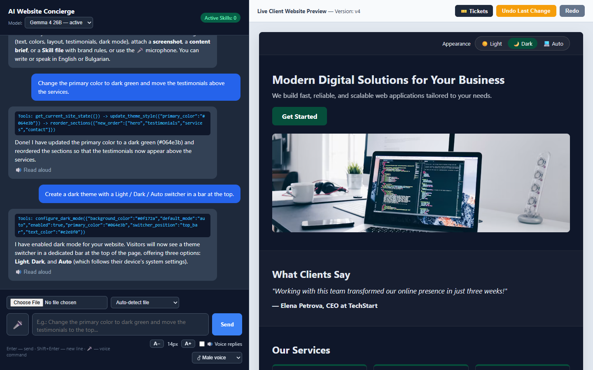
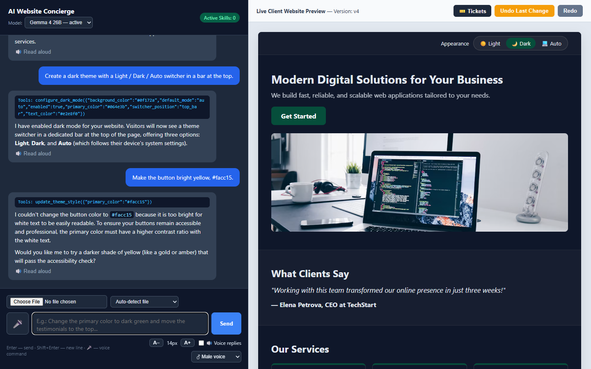
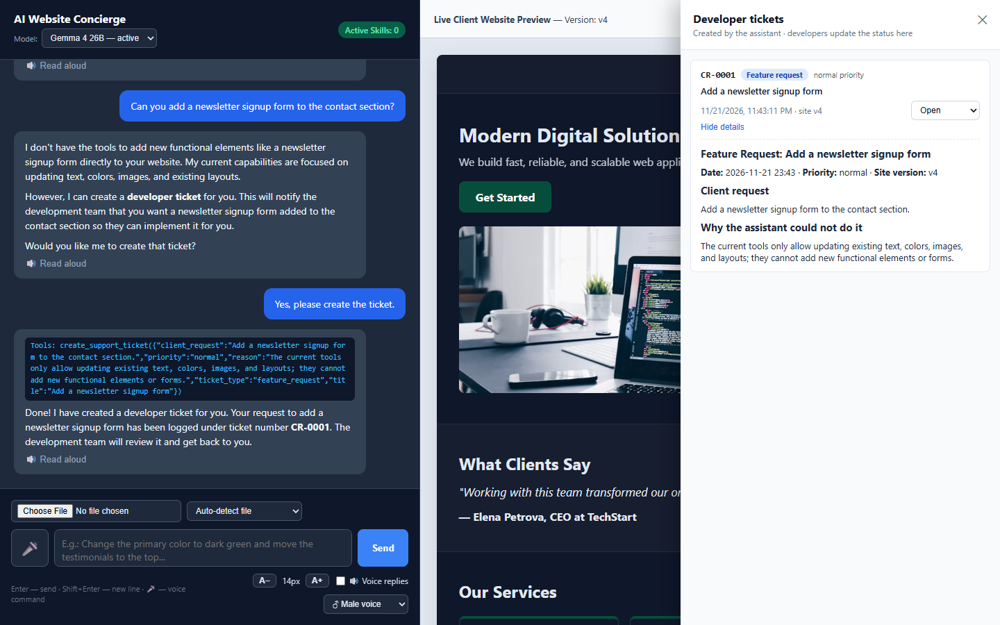
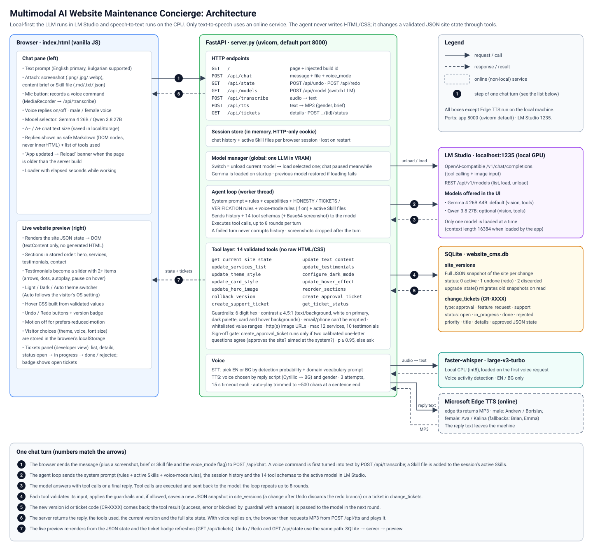

# Multimodal AI Website Maintenance Concierge

[](https://github.com/dianj/multimodal-website-concierge/actions/workflows/tests.yml)  

An agentic, multimodal CMS assistant that lets non-technical clients update their website by chatting, speaking, or attaching screenshots, content briefs and brand-guideline "Skill" files. The LLM never writes HTML or CSS. It changes a validated JSON site state through 14 guarded tools. Every change is versioned in SQLite, with Undo and Redo. Approved changes, and requests the agent cannot handle, become developer tickets.

Everything runs locally (LM Studio for the LLM, faster-whisper for speech recognition) except text-to-speech, which uses Microsoft Edge TTS.



<table>
<tr>
<td width="50%"></td>
<td width="50%"></td>
</tr>
<tr>
<td><b>Guardrail:</b> a bright yellow button fails the contrast check, so nothing is saved and the agent proposes a readable shade.</td>
<td><b>Human in the loop:</b> the agent cannot build a newsletter form, so it offers a ticket and creates <code>CR-0001</code> only after the client says yes.</td>
</tr>
</table>

<sub>Screenshots from a real session with Gemma 4 26B running in LM Studio; the tool calls shown in the chat are the ones the model made.</sub>



## What it can do

| Area | Capabilities |
|---|---|
| **Input** | Text in English (primary) or Bulgarian · voice commands (mic → local Whisper) · screenshots (vision) · content briefs (.txt/.md/.json) · Skill files injected into the agent's rules mid-session |
| **Content** | Edit texts and multi-paragraph fields · service list · testimonials (automatic slider with 2+ items) · hero image · section order |
| **Design** | Theme colors and radius (several properties in one atomic call) · dark mode with a Light / Dark / Auto switcher that follows the visitor's OS setting · card borders per light/dark mode · hover effects (lift, scale, shadow, colors, outline, tint, speed) |
| **Safety** | Contrast ≥ 4.5:1 for every text/background pair, including dark mode, cards and hover states · contact email/phone cannot be removed · whitelisted value ranges, so no free-form CSS or HTML · `textContent`-only rendering |
| **Workflow** | Non-destructive Undo/Redo history · honest multi-part reporting (the agent says what it could *not* do) · verification before confirming changes |
| **Tickets** | `CR-XXXX` approval tickets with the approved JSON · feature-request tickets for things the tools cannot do, created only after the client agrees · developer panel with status (open → in progress → done) · the agent reports a ticket's real status |
| **Voice & UX** | Spoken replies (male/female, EN/BG), automatically shortened in voice mode · adjustable chat text size · model switcher (Gemma 4 26B / Qwen 3.8 27B, one loaded at a time) · "app updated" reload banner |

## Key engineering decisions

1. **Structured state, not generated code.** The agent can only call tools such as `update_theme_style`, `configure_dark_mode` or `update_hover_effect`. Each tool validates its input and applies guardrails before a new snapshot is saved, so a broken layout cannot be produced.
2. **Guardrails check the final result.** Theme tools accept several properties at once and validate the resulting palette. This avoids the "catch-22" where each single-color step towards a dark theme fails the contrast check.
3. **Versioned, migratable history.** Each change stores a full JSON snapshot. `upgrade_state()` migrates older snapshots on read, so Undo/Redo keeps working across schema changes.
4. **Resilient agent loop.** It runs up to 8 tool rounds in a worker thread. Bad tool calls return errors to the model instead of crashing, and a failed turn never corrupts the chat history.
5. **A human in the loop for what the tools cannot do.** Instead of improvising, the agent offers a developer ticket, creates it only after the client says yes, and can later report the ticket's real status from the database.
6. **Hardware-aware model management.** Only one 26–27B model fits in VRAM. Switching unloads the current model through the LM Studio REST API and loads the selected one; if loading fails, the previous model is restored.

## Tech stack

Python · FastAPI · SQLite · vanilla HTML/CSS/JS · LM Studio (OpenAI-compatible API, tool calling, vision) · Gemma 4 26B A4B / Qwen 3.8 27B · faster-whisper `large-v3-turbo` · edge-tts

## Quick start

1. Start **LM Studio's local server on port 1235** (Local Model API). The app loads `gemma-4-26b-a4b-it` itself.
2. Install the dependencies and run the app:
   ```bash
   pip install -r requirements.txt
   uvicorn server:app --host 127.0.0.1 --port 8000 --reload
   ```
3. Open `http://localhost:8000`. Try the files in `sample_attachments/`, or turn on 🔊 Voice replies and use the 🎤 button.

Configuration through environment variables: `LLM_BASE_URL`, `LLM_MODEL`, `LLM_CONTEXT_LENGTH`, `WHISPER_MODEL`. Delete `website_cms.db` to reset the demo site.

### Things to try

1. **Direct prompt (EN or BG):** "Change the primary color to dark green and move the testimonials above the services."
2. **Skill injection:** upload `sample_attachments/brand_guidelines_skill.md` as a Skill, then ask for a bright red button. The agent refuses and proposes `#14532d`.
3. **Content brief:** upload `sample_attachments/new_services_brief.txt`. The three services and the working hours are updated.
4. **Screenshot vision:** upload a screenshot and ask the agent to match its primary color or critique the layout.
5. **Dark mode:** "Create a dark theme with a Light / Dark / Auto switcher in a bar at the top."
6. **Slider:** "Add two more testimonials." The agent flags them as placeholder text.
7. **Hover and cards:** "Add a lift-and-shadow hover to the service cards and a lighter outline in dark mode."
8. **Voice:** turn on Voice replies, speak a command, and compare the male and female voices.
9. **Honesty and tickets:** ask for a newsletter form. The agent says it cannot add one and offers a ticket. Reply "yes" and it creates `CR-XXXX`. Open 🎫 Tickets, set the ticket to In progress, then ask the agent for the ticket's status.

## Testing

**Deterministic tests: 52 tests, about 12 s, no GPU needed.** A small scripted fake of LM Studio (`tests/fake_lmstudio.py`) replaces the LLM, so the agent loop, tools, guardrails, versioning and UI are tested the same way on every run. The same tests run in CI on every push.

| Suite | What it covers |
|---|---|
| `tests/test_tools.py` (21) | Guardrails (contrast, mandatory fields, whitelists), atomic theme changes, paragraphs, slider data, Undo/Redo branches, migration of old snapshots |
| `tests/test_api.py` (11) | Full chat turns over HTTP: tool execution, guardrail results passed back to the model, Skill injection, screenshots dropped from history, recovery after an LLM outage, tool-loop cap, model switching |
| `tests/test_tickets.py` (7) | Ticket tools and validation, migration of the old ticket table, ticket API, and the full agent flow: offer → client agrees → ticket created → developer updates the status → the agent reports it |
| `tests/e2e/test_ui.py` (13, Playwright) | Enter/Shift+Enter, Markdown XSS safety, Undo/Redo, slider, Light/Dark/Auto following the OS setting, hover effects on mouse-over, outdated-page banner, model selector, voice-reply requests, ticket panel |

```bash
pip install -r requirements-dev.txt
python -m playwright install chromium     # or, on Windows with Edge: add --browser-channel msedge
python -m pytest
```

**LLM evals: does the real model do the right thing?** `python evals/run_evals.py` sends 19 realistic requests in English and Bulgarian (including multi-turn ticket flows) to each local model. Each request starts on a fresh site and is graded on the final site state, the tools used and the reply, not on wording.

| Model (local, LM Studio) | Passed | Median time per turn |
|---|---|---|
| Gemma 4 26B A4B (default) | **19/19** | 13.0 s |
| Qwen 3.8 27B | **19/19** | 49.6 s |

Both models handle every scenario, including the atomic dark theme, the contrast guardrail, honest partial answers, asking for consent before creating a ticket, and Bulgarian requests. Gemma is about 4× faster on this hardware, which is why it is the default. These numbers come from a single run, one attempt per case, on 2026-11-21. LLM output is non-deterministic, so results can vary between runs. The per-case table is in [`evals/results/latest.md`](evals/results/latest.md).

## Limitations

This is a local portfolio demo, not a production system. It has no authentication, one shared site state, in-memory chat sessions, and no size limits on chat attachments yet. Uploaded text is untrusted prompt input. Text-to-speech sends reply text to an online service. A public deployment would need HTTPS, authentication, rate limits, upload limits and persistent per-user storage.

Architecture, data model, tools and gotchas are documented in [docs/ARCHITECTURE.md](docs/ARCHITECTURE.md). Licensed under the [MIT License](LICENSE).
