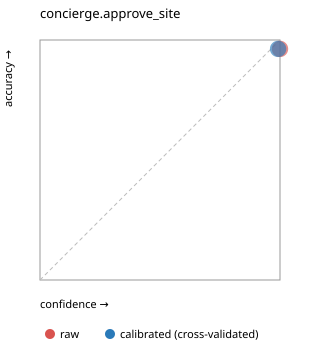

# Calibration: concierge.approve_site

Model `gemma-4-26b-a4b-it`, prompt `ee4cd227e186`, 27 labelled cases, fitted temperature **T = 4.1516** (2026-11-24).

| | accuracy | ECE | Brier |
|---|---|---|---|
| raw (T = 1) | 0.963 | 0.037 | 0.073 |
| calibrated, 5-fold cross-validated | 0.963 | 0.029 | 0.073 |

Risk-coverage (calibrated): the share of cases at or above each threshold and their accuracy.

| threshold | coverage | accuracy | n |
|---|---|---|---|
| 0.5 | 1.00 | 0.963 | 27 |
| 0.6 | 1.00 | 0.963 | 27 |
| 0.7 | 1.00 | 0.963 | 27 |
| 0.8 | 1.00 | 0.963 | 27 |
| 0.85 | 1.00 | 0.963 | 27 |
| 0.9 | 1.00 | 0.963 | 27 |
| 0.95 | 1.00 | 0.963 | 27 |
| 0.99 | 0.93 | 0.960 | 25 |

Cases labelled *unclear* (graded by action, not label): 5.

