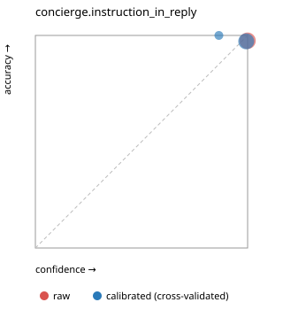

# Calibration: concierge.instruction_in_reply

Model `gemma-4-26b-a4b-it`, prompt `29bf2ee87365`, 32 labelled cases, fitted temperature **T = 2.8772** (2026-11-24).

| | accuracy | ECE | Brier |
|---|---|---|---|
| raw (T = 1) | 0.969 | 0.031 | 0.062 |
| calibrated, 5-fold cross-validated | 0.969 | 0.045 | 0.068 |

Risk-coverage (calibrated): the share of cases at or above each threshold and their accuracy.

| threshold | coverage | accuracy | n |
|---|---|---|---|
| 0.5 | 1.00 | 0.969 | 32 |
| 0.6 | 1.00 | 0.969 | 32 |
| 0.7 | 1.00 | 0.969 | 32 |
| 0.8 | 1.00 | 0.969 | 32 |
| 0.85 | 0.97 | 0.968 | 31 |
| 0.9 | 0.84 | 0.963 | 27 |
| 0.95 | 0.81 | 0.962 | 26 |
| 0.99 | 0.66 | 0.952 | 21 |

